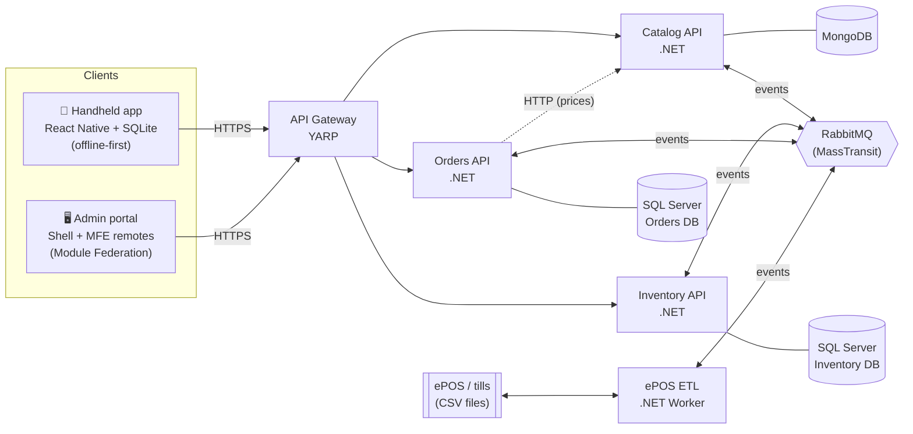
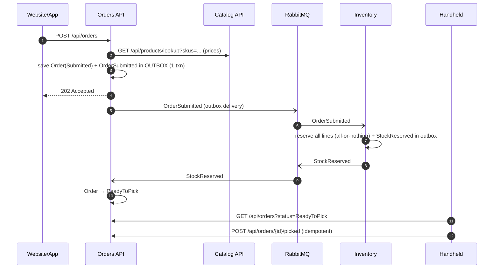

# Basecamp Retail: store operations platform

> **Purpose of this repository**
>
> This is a **technical capability demo** built for the **Senior Full-Stack Developer (.NET & React Native)** opportunity on a retail technology team. It is not a commercial product. It is a working, end-to-end system that shows how I design, build, test and deliver the kind of software that team owns:
>
> - **Custom apps on store handheld devices.** Here, an offline-first React Native app for stock lookups, stock counts and click & collect picking.
> - **Store administration and reporting through online portals.** Here, a React micro-frontend admin portal.
> - **ETL to and from the ePOS (tills).** Here, a .NET worker that imports till sales and exports price changes.
>
> Everything runs locally with one `docker compose up`, is covered by automated tests, and comes with a Kubernetes, Jenkins and Azure delivery path. The `docs/` folder explains every design decision, the trade-offs, and what I would do differently in production.
>
> "Basecamp" is a made-up outdoor retail brand. The domain was chosen to mirror the Retail team's remit: *"custom applications on our store handheld devices, store administration and reporting via online portals, and ETL to/from our ePOS solutions."*

---

## Contents

1. [What this demonstrates](#what-this-demonstrates)
2. [Architecture](#architecture)
3. [The components in detail](#the-components-in-detail)
4. [Key business flows](#key-business-flows)
5. [Reliability patterns](#reliability-patterns)
6. [Getting started](#getting-started)
7. [Testing](#testing)
8. [Delivery: Docker, Kubernetes, Jenkins, Azure](#delivery-docker-kubernetes-jenkins-azure)
9. [Deliberate shortcuts and production next steps](#deliberate-shortcuts-and-production-next-steps)
10. [Repository map](#repository-map)
11. [Further reading](#further-reading)

---

## What this demonstrates

| Capability the role asks for | Where it's shown |
|---|---|
| **C# / .NET 10**, ASP.NET Core Web API, REST | All of `backend/`: controllers, consumers, domain model, worker service |
| **Microservice design** | Database per service, events between services, gateway, idempotency (see `docs/03`) |
| **RabbitMQ with MassTransit** | Shared `Basecamp.Messaging` setup, consumers, retries, error queues, transactional outbox/inbox |
| **SQL Server + Entity Framework Core** | Inventory and Orders services: `rowversion` optimistic concurrency, outbox tables |
| **MongoDB** | Catalog service: product documents with varied attributes |
| **React + TypeScript** | `web/`: strict TypeScript, React 19 |
| **Micro-frontends** | Webpack 5 Module Federation: a shell plus two independently deployable remotes |
| **React Native** | `mobile/`: Expo SDK 58, React Native 0.88 |
| **Offline-first sync** | On-device SQLite outbox with an idempotent push/pull sync protocol |
| **Testing** | xUnit + MassTransit test harness, Jest + React Testing Library, Jest + RN Testing Library (63 tests) |
| **Docker, Kubernetes, Jenkins, GitFlow** | `docker-compose.yml`, `infra/k8s` (kustomize overlays), GitFlow-aware `Jenkinsfile` |
| **Azure** | One-script deployment: Bicep, Container Apps, Service Bus, Cosmos DB, Azure SQL |
| **Pragmatism and judgement** | Documented shortcuts with the production answer for each (see below) |
| **Mentoring and knowledge sharing** | `docs/`: onboarding-style guides, including a C# primer for TypeScript developers |

---

## Architecture



### Design principles

- **Each service owns one business capability and its data.** No service reads another's database. Catalog, Inventory and Orders each have their own store, chosen to fit the data.
- **Queries can be synchronous; side effects in other services are asynchronous events.** Orders asks Catalog for current prices over HTTP, because the customer is waiting and the price must be authoritative. Reserving stock in Inventory is an event, so an order is still accepted if Inventory is briefly down.
- **Every network hop has a plan for failure.** That means outbox/inbox, retries with error queues, idempotent handlers, resilient HTTP clients and per-remote error boundaries in the UI.
- **One front door.** Clients only ever talk to the YARP gateway, which routes by path and health-checks each service.

### Why each data store

| Service | Owns | Store | Why |
|---|---|---|---|
| **Catalog** | Products, barcodes, prices, attributes | MongoDB | Read-heavy, hierarchical data whose shape varies by category, which suits documents |
| **Inventory** | Stock per store and SKU, reservations, movement audit trail, device sync | SQL Server | Concurrency-critical counters, transactions and reporting queries, which suit a relational store |
| **Orders** | Click & collect orders and their lifecycle | SQL Server | A transactional state machine with relational order lines |
| **ePOS ETL** | Nothing (a stateless translator) | Files | The ePOS is a vendor product; files are its integration contract |

---

## The components in detail

### API gateway (`backend/src/Gateway`)

A **YARP** reverse proxy and the single public entry point. It routes by path, runs active health checks against each service's `/health` endpoint every 15 seconds, and owns the CORS policy for the browser clients.

| Path | Routed to |
|---|---|
| `/api/products/**` | Catalog |
| `/api/inventory/**` | Inventory |
| `/api/orders/**` | Orders |

### Catalog service (`backend/src/Services/Catalog`), MongoDB

Products, barcodes and prices. Changing a price publishes `ProductPriceChanged`, which the ETL turns into a price file for the tills.

| Endpoint | Purpose |
|---|---|
| `GET /api/products?search=&category=&page=` | Search and page through products |
| `GET /api/products/categories` | List categories |
| `GET /api/products/{sku}` | One product |
| `GET /api/products/barcode/{barcode}` | Look up by scanned barcode (used by the handheld) |
| `GET /api/products/lookup?skus=` | Batch lookup (used by Orders for pricing) |
| `PUT /api/products/{sku}` | Create or update a product |
| `PUT /api/products/{sku}/price` | Change a price (publishes `ProductPriceChanged`) |

### Inventory service (`backend/src/Services/Inventory`), SQL Server + EF Core

Stock per store and SKU. All stock rules live in the `StockItem` aggregate in `Inventory.Domain`, a pure domain project with no infrastructure dependencies:

- You can't reserve more than is available.
- A till sale is always recorded, even if it takes stock negative. The till is the source of truth, and negative stock signals that a count is needed.
- A stock count uses **"last counted wins" by the time the count was taken**, not when it arrived. A count taken at 10:00 that syncs at 15:00 can't overwrite a 12:00 count.
- A `rowversion` column provides optimistic concurrency. It also gives a cheap "changed since" checkpoint for device sync.

| Endpoint | Purpose |
|---|---|
| `GET /api/inventory/stores` | List stores |
| `GET /api/inventory/stores/{storeId}/stock` | Stock positions for a store |
| `GET /api/inventory/stores/{storeId}/stock/{sku}` | One stock position |
| `POST /api/inventory/stores/{storeId}/stock/{sku}/adjustments` | Relative adjustment with a reason (returns, damages, deliveries) |
| `GET /api/inventory/stores/{storeId}/movements` | Append-only audit trail of every stock change |
| `POST /api/inventory/sync/push` | Handheld uploads queued mutations (idempotent per mutation ID) |
| `GET /api/inventory/sync/pull?storeId=&since=` | Handheld downloads stock changed since its last checkpoint |

**Consumers:** `OrderSubmitted` (reserve stock, all-or-nothing), `OrderPicked` (fulfil the reservation), `SalesRecorded` (apply till sales).

### Orders service (`backend/src/Services/Orders`), SQL Server + EF Core

The click & collect order lifecycle: `Submitted` → `ReadyToPick` (or `Rejected`) → `ReadyForCollection` → `Collected`. It prices orders by calling Catalog through a typed `HttpClient` with .NET's standard resilience handler, which is built on Polly (timeouts, retry with jitter, circuit breaker).

| Endpoint | Purpose |
|---|---|
| `POST /api/orders` | Place an order. Returns **202 Accepted**, because stock is reserved asynchronously |
| `GET /api/orders/{id}` | Order and status |
| `GET /api/orders?storeId=&status=` | Pick list for a store (used by the handheld) |
| `POST /api/orders/{id}/picked` | Mark picked, moving it to `ReadyForCollection` and publishing `OrderPicked` (idempotent) |
| `POST /api/orders/{id}/collected` | Mark collected by the customer |

**Consumers:** `StockReserved` → `ReadyToPick`, `StockReservationFailed` → `Rejected` with the reason.

### ePOS ETL (`backend/src/Services/Etl/Epos.Etl`), .NET Worker Service

The integration with the third-party till system, through files:

- **Inbound sales.** The worker watches `data/epos/inbound/` for sales CSVs and parses and validates each row. Good rows are grouped per store and published as `SalesRecorded`. Bad rows are written to `data/epos/error/<file>.errors.txt` without blocking the rest of the file, and the original moves to `processed/`.
- **Outbound prices.** It consumes `ProductPriceChanged` and appends to a price file in `data/epos/outbound/` for the tills to pick up.

### Shared building blocks (`backend/src/BuildingBlocks`)

- **`Basecamp.Contracts`:** integration events as C# records. This is the only thing services share: `OrderSubmitted`, `StockReserved`, `StockReservationFailed`, `OrderPicked`, `SalesRecorded`, `ProductPriceChanged` and `StockLevelLow`.
- **`Basecamp.Messaging`:** one-line MassTransit setup with retry and redelivery policies, switchable between **RabbitMQ** (local, Kubernetes) and **Azure Service Bus** (Azure) through configuration.

### Handheld app (`mobile/`), React Native + Expo

Built for rugged store devices (e.g. Zebra) in stockrooms with poor Wi-Fi. **Every write is local first**: the colleague never waits on the network.

| Screen | What it does |
|---|---|
| **Lookup** | Scan or type a barcode or SKU to see product details and this store's stock. Hardware scanners (Zebra DataWedge) act as a keyboard, so a focused `TextInput` with `onSubmitEditing` handles scans without any camera code. |
| **Stock count** | Record physical counts. They're written to the on-device outbox instantly and synced later, and they work the same online and offline. |
| **Pick list** | Click & collect orders that are ready to pick. Loading the list needs the network, but marking an order picked is queued like any other change, so picking can continue in a dead spot. |

**The offline sync engine** (`src/sync/SyncEngine.ts` on the device, `Inventory.Api/Sync/SyncService.cs` on the server):

1. **Write locally.** Each change goes into a SQLite outbox with a client-generated UUID.
2. **Push.** Queued mutations are uploaded in batches. The server is **idempotent by mutation ID**, so a retry after a dropped connection is harmless. Counts use "last counted wins"; adjustments use deltas.
3. **Handle the result.** Accepted mutations leave the outbox. Rejected ones (e.g. an unknown SKU) are **parked** with the reason so they don't block the queue. Network errors are retried.
4. **Pull.** The device downloads stock changed since its last `rowversion` checkpoint. It never overwrites a row that still has local changes waiting to sync.

A sync runs straight after each change is recorded, whenever connectivity returns (via NetInfo), and every 30 seconds in the background. The status bar shows online/offline, pending and rejected counts, and the last sync time. Navigation is deliberately a simple tab state rather than a navigation library, because three task-focused screens don't need stacks or deep linking yet.

### Admin portal (`web/`), React micro-frontends

A **shell** application that loads two **remotes** at runtime with Webpack 5 Module Federation. Each remote can be built, tested and deployed independently.

| Package | Role | Dev port |
|---|---|---|
| `shell` | Host: layout, navigation, loads the remotes, wraps each one in an error boundary | 3000 |
| `mfe-catalog` | Remote: product search and price changes | 3001 |
| `mfe-inventory` | Remote: store stock levels, low-stock filter, write-off adjustments | 3002 |
| `shared` | The contract between shell and remotes (props and types only) | — |

- React is shared as a **singleton** negotiated at runtime, behind an async bootstrap boundary.
- Remotes communicate only through a minimal contract (props from the shell plus browser events). There's no shared global store.
- **If a remote fails to load, only that panel shows an error.** The rest of the portal keeps working, and this is covered by a test in `Shell.test.tsx`.

In Docker, all three are built into one nginx image served on port 8080.

---

## Key business flows

### Click & collect (event choreography)



If any line is short, Inventory publishes `StockReservationFailed` instead and the order becomes `Rejected` with the reason. If two orders race for the last unit, the `rowversion` check makes exactly one win.

### Handheld offline sync

A colleague counts stock in a stockroom with no signal. The count is saved to SQLite immediately. When the device reconnects, the outbox is pushed, the server applies each mutation exactly once (deduplicated by mutation ID), and the device pulls any stock that changed elsewhere in the meantime.

### ePOS integration

The tills drop a sales file, and the ETL publishes `SalesRecorded` per store, which Inventory consumes to reduce stock. In the other direction, a price change in the admin portal publishes `ProductPriceChanged`, and the ETL writes it to the outbound price file for the tills.

---

## Reliability patterns

| Problem | Pattern used | Where |
|---|---|---|
| Saving data and publishing an event are two separate operations (the dual-write problem) | **Transactional outbox**: the event is stored in the same SQL transaction and delivered afterwards | Inventory, Orders (MassTransit EF outbox) |
| Brokers deliver at least once, so duplicates happen | **Inbox** deduplication by message ID, plus business-key idempotency (`ProcessedKeys`) | Inventory, Orders |
| Two writers change the same stock row | **Optimistic concurrency** with `rowversion`; MassTransit retries the consumer with fresh data | `StockItem` |
| A consumer keeps failing | Immediate retries, then delayed redelivery, then an `_error` queue for inspection and replay | `Basecamp.Messaging` |
| A synchronous dependency is slow or down | Standard resilience handler (Polly): timeouts, retry with jitter, circuit breaker | Orders → Catalog |
| A bad row in a till file | Per-row validation; bad rows go to an error report and good rows still import | ePOS ETL |
| A device sends the same change twice | Idempotent sync by client mutation ID; rejected mutations are parked | Inventory sync API |
| One micro-frontend crashes | Error boundary + Suspense per remote | Admin portal shell |

---

## Getting started

### Prerequisites

- **Docker Desktop.** On Apple Silicon, enable Rosetta, because SQL Server runs as an amd64 image.
- **Node 22+.**
- **.NET 10 SDK.** Only needed to run the backend tests or the services outside Docker.
- For the handheld app: the **iOS Simulator** (Xcode), an **Android emulator**, or **Expo Go** on a phone.

### 1. Backend, infrastructure and admin portal

```bash
docker compose up --build        # first build takes a few minutes
```

| What | URL |
|---|---|
| API gateway | http://localhost:5050/api/products |
| Admin portal | http://localhost:8080 |
| RabbitMQ management UI | http://localhost:15672 (guest / guest) |
| MongoDB | `mongodb://localhost:27017` |
| SQL Server | `localhost,1433` (sa / see `docker-compose.yml`) |

> **Why port 5050 and not 5000?** On macOS, AirPlay Receiver listens on port 5000, so the gateway is published on 5050 to avoid the clash.

### 2. Handheld app

```bash
cd mobile && npm install
npx expo start                   # press i for iOS Simulator, a for Android, or scan the QR code with Expo Go
```

The app calls `http://localhost:5050` by default, which works for the iOS Simulator. Override it for other targets:

```bash
EXPO_PUBLIC_API_URL=http://10.0.2.2:5050 npx expo start          # Android emulator
EXPO_PUBLIC_API_URL=http://<your-LAN-IP>:5050 npx expo start     # physical phone
```

### 3. Admin portal in dev mode (optional, with hot reload)

```bash
cd web && npm install && npm start     # shell :3000, catalog :3001, inventory :3002
```

### 4. Try the flows

```bash
# Place a click & collect order, then poll it: Submitted → ReadyToPick within about a second
curl -X POST http://localhost:5050/api/orders -H 'Content-Type: application/json' -d '{
  "storeId":"STORE-001","customerName":"Alex","customerEmail":"alex@example.com",
  "lines":[{"sku":"BC-JKT-001","quantity":1}]}'

# Feed the ETL a sales file from the tills
mkdir -p data/epos/inbound && cp backend/sample-data/epos-sales-20261109.csv data/epos/inbound/
```

The **[guided tour](docs/00-guided-tour.md)** walks through every concept with something you can watch happen: messages in the RabbitMQ UI, race conditions, offline counts syncing, and a failing micro-frontend.

---

## Testing

```bash
cd backend && dotnet test BasecampRetail.slnx
cd mobile  && npm test && npm run typecheck
cd web     && npm test && npm run typecheck && npm run build
```

| Suite | Tooling | Tests | Covers |
|---|---|---|---|
| `Inventory.Domain.Tests` | xUnit | 14 | Stock rules: reservations, sales, "last counted wins", all-or-nothing reservation |
| `Inventory.Api.Tests` | xUnit + MassTransit test harness + EF InMemory | 2 | `OrderSubmitted` consumer publishes the right event and reserves stock |
| `Epos.Etl.Tests` | xUnit | 5 | Sales CSV parsing and validation |
| `mobile/__tests__` | Jest + React Native Testing Library | 13 | Sync engine (push, pull, rejections, retries), Lookup and Stock count screens |
| `web/*` | Jest + React Testing Library | 8 | Shell remote isolation, catalog and inventory remotes |

The strategy is a testing pyramid. Logic is pushed into pure, fast units (the domain model, CSV parser and sync engine). Consumers are tested on a real in-memory bus. UI is tested by role and label, the way a user finds things. The next step would be integration tests with `WebApplicationFactory` and Testcontainers against real SQL Server and RabbitMQ.

---

## Delivery: Docker, Kubernetes, Jenkins, Azure

- **Docker.** One multi-stage `backend/Dockerfile` builds any service (the project is a build argument). `web/Dockerfile` builds the shell and remotes into nginx. `docker-compose.yml` runs the whole platform.
- **Kubernetes** (`infra/k8s`). Kustomize base manifests for every service, with **dev / staging / prod overlays** and an `infra-local` set (RabbitMQ, MongoDB, SQL Server) for local clusters.
- **Jenkins** (`Jenkinsfile`). A declarative, **GitFlow-aware** pipeline:
  1. Run backend, handheld and portal tests in parallel.
  2. Build and push images.
  3. Deploy to **DEV** (from `develop`), then **STAGING** (`release/*`).
  4. Pause for a **manual approval** before **PRODUCTION** (`main`).
- **Azure** (`infra/azure`). One script (`deploy.sh` + `main.bicep`) provisions Container Apps, **Azure Service Bus** (replacing RabbitMQ, a config switch in `Basecamp.Messaging`), **Cosmos DB for MongoDB** and **Azure SQL**. It builds images in Azure with `az acr build`, so local Docker isn't needed. Costs and teardown are covered in `docs/10`.

---

## Deliberate shortcuts and production next steps

These are pragmatic choices for a demo, not oversights. Each has a known production answer:

| Shortcut | Production answer |
|---|---|
| `EnsureCreated()` at startup | EF Core migrations, applied by a pipeline step or Kubernetes Job |
| Catalog publishes after its Mongo write (no outbox) | MassTransit MongoDB outbox (needs a replica set) |
| No authentication | Entra ID (Azure AD) JWTs validated at the gateway and services; device identity for handhelds |
| Choreography without cancellation | `OrderCancelled` + compensation, or a MassTransit **saga state machine** as the flow grows |
| ETL polls a folder | Blob Storage + Event Grid trigger, or an SFTP landing zone |
| Basic logging | OpenTelemetry traces across HTTP and RabbitMQ into Application Insights |
| Handheld config via environment variables | MDM-pushed configuration per store and device (e.g. Intune, SOTI) |
| MassTransit 8 | v9 is commercially licensed; licence it, stay on v8, or migrate, with the transport kept behind `Basecamp.Messaging` to ease any move |

Natural next steps: an order **saga** with cancellation and timeouts, **OpenTelemetry** tracing end to end, **Testcontainers** integration tests for the sync API, and a **reporting** micro-frontend over the stock-movement audit trail (shrinkage by store).

---

## Repository map

| Path | What | Key tech |
|---|---|---|
| `backend/src/BuildingBlocks/Basecamp.Contracts` | Integration events shared by services | C# records |
| `backend/src/BuildingBlocks/Basecamp.Messaging` | One-line MassTransit setup, RabbitMQ or Azure Service Bus | MassTransit 8 |
| `backend/src/Services/Catalog` | Products, barcodes, prices | ASP.NET Core Web API, MongoDB |
| `backend/src/Services/Inventory` | Stock per store, reservations, handheld sync API, audit trail | EF Core, SQL Server, outbox/inbox |
| `backend/src/Services/Orders` | Click & collect orders | EF Core, SQL Server, typed HttpClient + Polly |
| `backend/src/Services/Etl/Epos.Etl` | ePOS sales import and price export | .NET Worker Service |
| `backend/src/Gateway` | Single entry point | YARP |
| `backend/tests` | Domain, consumer and parser tests | xUnit, MassTransit test harness |
| `backend/sample-data` | A sample ePOS sales file | CSV |
| `mobile/` | Store handheld app | Expo SDK 58, RN 0.88, expo-sqlite, NetInfo, Jest, RNTL |
| `web/` | Admin portal: `shell`, `mfe-catalog`, `mfe-inventory`, `shared` | React 19, Webpack 5 Module Federation, Jest, RTL |
| `infra/k8s` | Kubernetes manifests (base + dev/staging/prod overlays) | kustomize |
| `infra/azure` | Azure deployment | Bicep, Container Apps, Service Bus, Cosmos DB, Azure SQL |
| `Jenkinsfile` | CI/CD pipeline | Jenkins declarative, GitFlow |
| `docs/` | Concept guides and design rationale | |

---

## Further reading

| # | Guide | Covers |
|---|---|---|
| 00 | [Guided tour](docs/00-guided-tour.md) | The system, by doing |
| 01 | [Architecture](docs/01-architecture.md) | How it fits together, the key flows, and why |
| 02 | [C# & .NET for TypeScript developers](docs/02-csharp-dotnet-primer.md) | Every C# feature used in this repo, mapped to TypeScript |
| 03 | [Microservices](docs/03-microservices.md) | Design principles, consistency, idempotency, pitfalls |
| 04 | [RabbitMQ & MassTransit](docs/04-messaging-rabbitmq-masstransit.md) | Exchanges and queues, retries, outbox/inbox, error queues |
| 05 | [Data: SQL Server, EF Core, MongoDB](docs/05-data-sqlserver-ef-mongodb.md) | When to use which, concurrency, modelling |
| 06 | [React Native offline-first](docs/06-react-native-offline-first.md) | Outbox, sync protocol, conflicts, Ditto/Couchbase comparison |
| 07 | [Micro-frontends](docs/07-micro-frontends.md) | Module Federation, contracts, isolation, trade-offs |
| 08 | [Testing](docs/08-testing.md) | xUnit, test harness, Jest, RTL/RNTL, code review checklist |
| 09 | [Docker, Kubernetes, Jenkins, GitFlow](docs/09-devops.md) | The delivery pipeline end to end |
| 10 | [Deploying to Azure](docs/10-azure-deployment.md) | Step-by-step deployment, costs, teardown |
