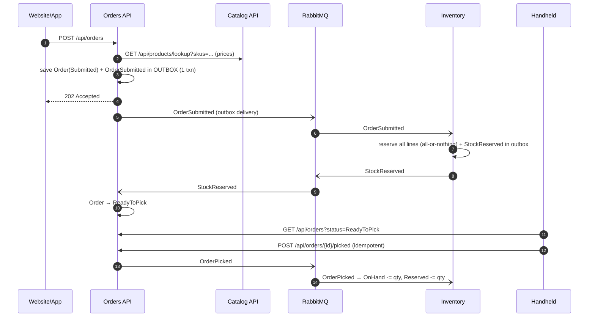
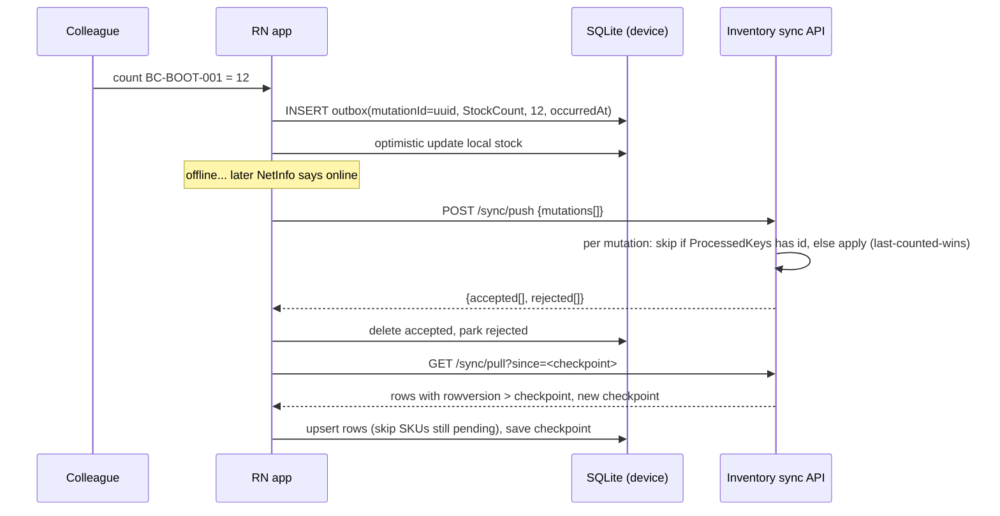
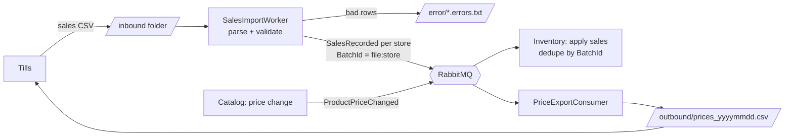

# 01 — Architecture: how it all fits together

## The business problem

An outdoor retailer with hundreds of stores needs:

1. **Store colleagues** on handheld devices (rugged Android, e.g. Zebra) to look up products, count stock and pick click & collect orders. **Stockrooms often have poor Wi-Fi, so the app must work offline.**
2. **Store managers and head office** to manage prices and see stock and reports in a web portal.
3. The **ePOS** (a third-party till system) to stay in sync: sales flow *in*, price changes flow *out*.

## Bounded contexts → services

Each service owns one business capability **and its data**. No other service touches its database.

| Service | Owns | Store | Why that store |
|---|---|---|---|
| **Catalog** | Products, barcodes, prices, variants, attributes | MongoDB | Read-heavy, hierarchical, shape varies by category → documents |
| **Inventory** | Stock per (store, sku), reservations, movements audit, device sync | SQL Server | Concurrency-critical counters, transactions, reporting queries → relational |
| **Orders** | Click & collect orders and their lifecycle | SQL Server | Transactional state machine, relational lines |
| **ePOS ETL** | Nothing (stateless translator) | Files | The ePOS is a vendor product. Files are its integration contract |
| **Gateway** | Nothing | — | One public entry point |

## Communication: when sync, when async

| Interaction | Style | Why |
|---|---|---|
| Client → any service | **HTTP via gateway** | Request/response, the user is waiting |
| Orders → Catalog (current prices) | **HTTP** (typed HttpClient + resilience) | A *query* for authoritative data, needed right now |
| Orders → Inventory (reserve stock) | **Event** `OrderSubmitted` | A *side effect* in another service. It shouldn't fail the order if Inventory is briefly down |
| Inventory → Orders (result) | **Event** `StockReserved` / `StockReservationFailed` | Same |
| Catalog → ePOS (price) | **Event** `ProductPriceChanged` → ETL → file | Many potential subscribers, fire-and-forget |
| ePOS → Inventory (sales) | File → ETL → **Event** `SalesRecorded` | Batch integration, decoupled |

Rule of thumb: **"Queries can be synchronous. Side effects in other services should be asynchronous events. Every hop over the network needs a plan for failure."**

## Key flows

### Click & collect (choreography)

### Handheld offline sync

### ePOS integration (ETL)

## Reliability patterns used (and where)

| Pattern | Problem it solves | Where |
|---|---|---|
| **Transactional outbox** | "Saved to DB but crashed before publishing" (dual write) | Inventory, Orders (MassTransit EF outbox) |
| **Inbox / idempotent consumer** | Broker redelivers a message → applied twice | Inventory, Orders (MassTransit inbox) |
| **Business idempotency keys** | Producer re-sends the same thing as a *new* message | `ProcessedKeys` table: device mutation ids, ePOS batch ids |
| **Optimistic concurrency** | Two writers race on the same row | `rowversion` on `StockItem` |
| **Retry + delayed redelivery + error queue** | Transient failures vs poison messages | `MessagingExtensions.ConfigureCommon` |
| **Resilience pipeline** (retry, timeout, circuit breaker) | Flaky synchronous dependency | Orders → Catalog HttpClient |
| **Device outbox + checkpoint sync** | Offline work, lost responses | Mobile `SyncEngine` |
| **Error boundary per micro-frontend** | One broken remote takes down the portal | `RemoteBoundary` |

## Deliberate shortcuts (and what you'd do in production)

Being able to name these shows judgement. They are pragmatic choices, not oversights.

| Shortcut | Production answer |
|---|---|
| `EnsureCreated()` at startup | EF migrations, applied by a pipeline step or k8s Job |
| Catalog publishes after Mongo write (no outbox) | MassTransit MongoDB outbox (needs a replica set) |
| No auth | Entra ID (Azure AD) JWT validated at the gateway and services; device auth for handhelds |
| Choreography without cancellation | Add `OrderCancelled` + compensation, or a MassTransit **saga state machine** when the flow grows |
| ETL polls a folder | Blob Storage + Event Grid trigger, or SFTP landing zone |
| Basic logging | OpenTelemetry traces across HTTP and RabbitMQ → Application Insights |
| Handheld config via env vars | MDM-pushed config (e.g. Intune / SOTI) per store/device |
