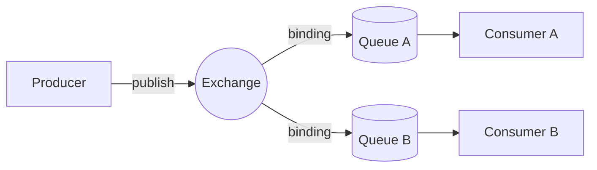

# 04 — Messaging: RabbitMQ & MassTransit

## RabbitMQ in 2 minutes

RabbitMQ is a **message broker** that speaks AMQP 0-9-1. Producers never send to a queue directly. They send to an **exchange**, which routes copies to **queues** via **bindings**.



| Term | Meaning |
|---|---|
| **Exchange** | Router. Types: *fanout* (copy to all bound queues), *direct* (exact routing key), *topic* (pattern `stock.*.low`), *headers* |
| **Queue** | Ordered buffer that a consumer reads from. Durable queues survive broker restarts |
| **Binding** | Rule linking an exchange to a queue (or to another exchange) |
| **Ack / Nack** | The consumer confirms processing. Un-acked messages are redelivered if the consumer dies → **at-least-once** |
| **Prefetch** | How many un-acked messages a consumer may hold at once (throughput vs fairness) |
| **Competing consumers** | N instances read the SAME queue → load is spread, each message goes to one instance |
| **Dead-letter** | Where messages go when they can't be processed |
| **vhost** | Namespace isolation inside one broker |

## Why MassTransit on top?

You *could* use `RabbitMQ.Client` directly. MassTransit gives you, with a few lines of code:

- **Topology conventions**: exchanges, queues and bindings created from your types.
- **Typed consumers** with DI scopes (one `DbContext` per message).
- **Retry, redelivery and error queues**.
- **Transactional outbox and inbox** (EF Core, MongoDB).
- **Sagas** (state machines), request/response, scheduling.
- **Transport abstraction**: RabbitMQ ⇄ Azure Service Bus ⇄ Amazon SQS ⇄ in-memory, chosen by config.
- **Test harness**.

### How MassTransit maps your code to RabbitMQ

```csharp
await publishEndpoint.Publish(new OrderSubmitted(...));     // in Orders
public class OrderSubmittedConsumer : IConsumer<OrderSubmitted>  // in Inventory
```

Creates:

```
Exchange  "Basecamp.Contracts:OrderSubmitted"  (fanout, named after the message TYPE)
     │ binding
     ▼
Exchange  "order-submitted"  ──▶  Queue "order-submitted"  ──▶  OrderSubmittedConsumer
          (named after the CONSUMER via SetKebabCaseEndpointNameFormatter)
```

- **Publish** = event (fan-out to every subscriber). If Reporting later wants `OrderSubmitted`, it adds a consumer and gets its own queue. **Orders doesn't change.** That's the decoupling.
- **Send** = command to one specific queue (`ISendEndpoint`). Use it for "do this" rather than "this happened".
- Message **type name is the contract**. Renaming or moving `OrderSubmitted` changes the exchange name, which silently breaks subscribers. Keep contracts in a stable namespace and evolve them additively.
- Messages travel as JSON in an envelope (`messageId`, `correlationId`, `conversationId`, `sentTime`, `messageType`, `message`).

Explore it: http://localhost:15672 → Exchanges / Queues while running the guided tour.

## Failure handling (`MessagingExtensions.ConfigureCommon`)

```csharp
cfg.UseDelayedRedelivery(r => r.Intervals(30s, 2m, 10m));   // 2nd level: back to broker, later
cfg.UseMessageRetry(r => r.Exponential(5, 100ms, 5s, 200ms)); // 1st level: in-memory, immediately
```

```
consume fails → retry 5× in-process (exponential)
             → still failing → redeliver in 30s → retry 5×
             → redeliver in 2m → ... → 10m → ...
             → give up → move to "order-submitted_error" queue
```

- **Transient faults** (deadlock, timeout, concurrency conflict) are fixed by the immediate retry.
- **Longer outages** (DB down for minutes) are handled by delayed redelivery, which doesn't block the consumer while waiting.
- **Poison messages** (bug, bad data) end up in the **`_error` queue** with the exception in the headers. Fix the bug, then move them back to the main queue (RabbitMQ UI "shovel" or MassTransit tooling). Monitor `_error` queue depth and alert on it.
- Delayed redelivery on RabbitMQ needs the **delayed-message-exchange plugin**. That's why docker-compose uses the `masstransit/rabbitmq` image. Azure Service Bus has scheduling built in.

You can also exclude exceptions from retry: `r.Ignore<ValidationException>()` (retrying a validation error is pointless).

## Transactional outbox and inbox (the most important pattern here)

**Problem (dual write):**
```csharp
db.SaveChanges();          // ✅ committed
// 💥 crash / broker down
bus.Publish(evt);          // ❌ never sent → Inventory never reserves → order stuck forever
```

**MassTransit EF outbox** (Inventory, Orders):
```csharp
x.AddEntityFrameworkOutbox<InventoryDbContext>(o => { o.UseSqlServer(); o.UseBusOutbox(); });
x.AddConfigureEndpointsCallback((ctx, _, cfg) => cfg.UseEntityFrameworkOutbox<InventoryDbContext>(ctx));
modelBuilder.AddInboxStateEntity(); AddOutboxMessageEntity(); AddOutboxStateEntity();
```

1. `Publish()` writes a row to **`OutboxMessage`** in the **same `SaveChanges` transaction** as your business data. Both commit, or neither does.
2. A hosted **delivery service** reads `OutboxMessage` and sends to the broker, then marks the rows delivered.
3. On the consumer side, **`InboxState`** records the `MessageId`. A redelivered duplicate is detected and skipped.

Result: **exactly-once *processing* semantics on top of at-least-once *delivery***. (Truly exactly-once delivery doesn't exist in distributed systems.)

`UseBusOutbox()` extends this to publishes made **outside** consumers (controllers, `SyncService`).

**Catalog does NOT use an outbox** (it publishes after the Mongo write). That's a deliberate, documented trade-off. The fix is `AddMongoDbOutbox`, which needs Mongo running as a replica set for transactions.

## Ordering

RabbitMQ preserves order *within a queue*, but retries, redelivery and competing consumers break global ordering. **Design so order doesn't matter**:
- Stock counts carry `occurredAt` → "last counted wins" regardless of arrival order.
- Sales are deltas (commutative: −1 then −2 = −2 then −1).
- Status transitions are guarded (`Submitted → ReadyToPick` only from `Submitted`).

## RabbitMQ vs Azure Service Bus

| | RabbitMQ | Azure Service Bus |
|---|---|---|
| Hosting | You run it (VM/k8s/CloudAMQP) | Fully managed PaaS |
| Pub/sub | Exchanges + queues | Topics + subscriptions (Standard tier+) |
| Scheduling / delay | Plugin | Native |
| Dead-letter | `_error` queue (MassTransit) / DLX | Native DLQ per queue/subscription |
| Sessions / FIFO | Single-active-consumer | Message sessions |
| Cost model | Your infra | Per operation / tier |

With MassTransit the switch is configuration only (`Messaging:Transport`), which is how this project deploys to Azure without code changes.

## ⚠️ The licensing story

- **MassTransit v8** is Apache-2.0 open source. **This repo pins 8.x.**
- **MassTransit v9** (released early 2026) is **commercially licensed**. Official v8 maintenance runs to the **end of 2026**.
- So a team on v8 must decide **now**: buy v9, stay on v8 unsupported, or migrate (Wolverine, Rebus, Brighter, NServiceBus, or raw `RabbitMQ.Client`, or Azure SDK).

Keeping services coded against thin abstractions (our `AddBasecampMessaging` and `IPublishEndpoint` usage) limits the blast radius of such a migration.
