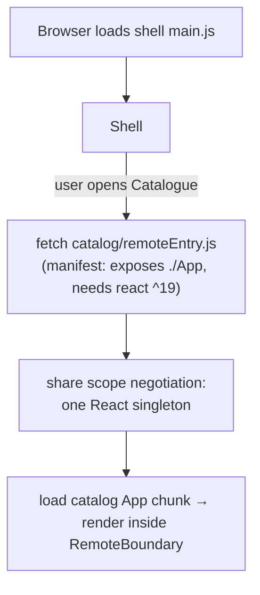

# 07 — Micro-frontends (Webpack Module Federation)

## What and why

> Micro-frontends apply microservice thinking to the UI: **independently built and deployed frontend slices, each owned by one team, composed into one app at runtime.**

Why a multi-team retailer might use them:
- Product-based teams can each **ship their slice of the portal on their own cadence**.
- Legacy and greenfield coexist: an old section can be replaced piece by piece (the "strangler fig" pattern).
- Smaller codebases are faster to build, test and understand.

Costs: more infrastructure, runtime coupling via shared dependencies, a consistent UX needs a design system, and a slightly heavier page. **Not worth it for a small single-team app.**

## Our setup (`web/`)

```
web/
  webpack.common.js     shared webpack factory (Module Federation config lives here)
  shared/               @basecamp/mfe-contracts: RemoteAppProps + notify() events
  shell/   :3000        HOST: header, nav, store selector, toasts, error boundaries
  mfe-catalog/ :3001    REMOTE: exposes ./App (products, price changes)
  mfe-inventory/ :3002  REMOTE: exposes ./App (stock, low-stock, write-offs)
```



### The mechanics (`webpack.common.js`)

```js
new ModuleFederationPlugin({
  name: 'catalog',                      // global container name
  filename: 'remoteEntry.js',           // the manifest/entry hosts load
  exposes: { './App': './src/App' },    // what this remote offers (remote only)
  remotes: { catalog: 'catalog@http://localhost:3001/remoteEntry.js' }, // what to consume (host only)
  shared: { react: { singleton: true, requiredVersion: '^19.2.0' }, 'react-dom': { ... } },
})
```

- **`exposes` / `remotes`**: remotes publish modules, and hosts import them like local code: `lazy(() => import('catalog/App'))`.
- **`shared` + `singleton`**: only one React may exist on the page (hooks break otherwise). At runtime the containers negotiate which loaded version satisfies everyone's `requiredVersion`.
- **The async boundary** (`index.ts` → `import('./bootstrap')`): gives webpack a tick to set up the share scope *before* React is imported. Skip it and you get *"Shared module is not available for eager consumption"*.
- **`publicPath: 'auto'`**: chunks load relative to wherever `remoteEntry.js` came from, so the same build works on localhost or under `/catalog/` behind nginx.
- **Remote URLs come from env vars** (`CATALOG_REMOTE_URL`), so dev, docker and Azure use the same code. Advanced: *dynamic remotes* read the URLs from a runtime manifest JSON, so you can repoint without rebuilding the shell.

### The contract (`shared/src/index.ts`)
Keep it **tiny**:
1. **Props in:** `RemoteAppProps { apiBaseUrl, storeId }`. The shell owns "which store is selected" and passes it down.
2. **Events out:** `notify({level, message})` dispatches a `CustomEvent` on `window`, and the shell listens and shows a toast.

No shared Redux store and no importing each other's components. Loose coupling is the whole point. TypeScript types for remotes are declared in `shell/src/remotes.d.ts`, typed against the shared contract.

### Isolation (`shell/src/RemoteBoundary.tsx`)
`Suspense` (loading state) plus an **error boundary** around each remote. If the inventory server is down or its code throws, only that panel shows "Stock is unavailable right now", and the rest of the portal works. There's a test for exactly this in `Shell.test.tsx`.

### Independent development and testing
- Each remote runs **standalone** (`bootstrap.tsx` renders itself with defaults), so a team doesn't need the shell to work.
- Each has its **own Jest + React Testing Library tests** and its own build.
- The shell is tested with **fake remotes** (plain components in a registry).

### Deployment
- `web/Dockerfile` builds all three into one nginx (`/`, `/catalog/`, `/inventory/`) to keep the demo simple. In a real org each remote has its **own pipeline** and deploys to its own path or CDN.
- **Never cache `remoteEntry.js`** (`Cache-Control: no-cache` in `nginx.conf`). It's the pointer to the latest build. Hashed chunks can be cached forever.

## Alternatives (know the landscape)

| Approach | Notes |
|---|---|
| **Module Federation (webpack/rspack)** | Runtime composition, shared deps. Most common in React shops. *Module Federation 2.0* (`@module-federation/enhanced`) adds a manifest, type sharing and a runtime plugin API |
| **Native Federation / Vite federation plugins** | Same idea for Vite/ESM builds |
| **single-spa** | Framework-agnostic orchestrator with lifecycle hooks, can mix React/Angular/Vue |
| **Web Components** | Framework-neutral custom elements. Good isolation (Shadow DOM) |
| **iframes** | Strongest isolation, worst UX/perf. Still valid for embedding legacy apps |
| **Build-time packages** (npm libs) | Simple, but every change needs a host rebuild and redeploy, so it's not independent deployment |
| **Server-side composition** (ESI, Next.js multi-zones) | Composition at the edge/server |

## Pitfalls to mention
- **Shared dependency drift**: if remotes upgrade React at different times, the singleton negotiation can fail. Agree version ranges and upgrade together.
- **CSS collisions**: use CSS Modules, CSS-in-JS with prefixes, or Shadow DOM, plus a shared design system package.
- **Too many tiny remotes**: split by business domain/team, not by component.
- **Cross-remote state**: if two remotes need lots of shared state, the boundary is probably wrong.
