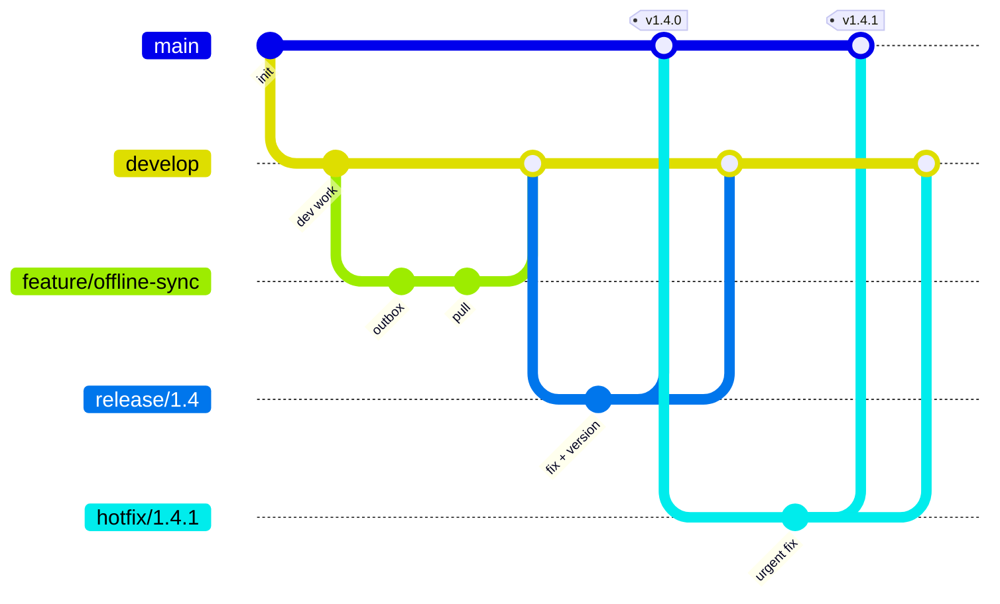

# 09 — Docker, Kubernetes, Jenkins, GitFlow

## Docker

`backend/Dockerfile` is **one parameterised, multi-stage Dockerfile** for all five .NET services:

```dockerfile
FROM mcr.microsoft.com/dotnet/sdk:10.0 AS build        # big image with compilers
COPY Directory.Build.props Directory.Packages.props ./
COPY src/ src/
RUN dotnet restore "$PROJECT" && dotnet publish ... -o /app
FROM mcr.microsoft.com/dotnet/aspnet:10.0              # small runtime-only image
COPY --from=build /app .
ENV Urls=http://+:8080                                  # .NET 8+ default non-root port
USER $APP_UID                                           # don't run as root
```
Why it's built this way: multi-stage keeps the final image small and free of compilers. Layer ordering maximises cache hits. The non-root user (`APP_UID` ships in .NET 8+ images). `.dockerignore` excludes `bin/` and `obj/`.

`web/Dockerfile` builds the shell and remotes with Node, then serves them with nginx.

`docker-compose.yml` runs everything locally. Things to notice: `depends_on: condition: service_healthy` (services wait for SQL Server and RabbitMQ health checks), env-var config overrides (`ConnectionStrings__InventoryDb`), and a YAML anchor (`x-dotnet-env`) for shared settings.

## Kubernetes (`infra/k8s`)

```
base/                    one Deployment + Service per service, ConfigMap, Secret, Ingress, HPA
infra-local/             RabbitMQ/Mongo/SQL in-cluster (DEV ONLY)
overlays/dev|staging|prod  kustomize patches per environment
```
Deploy: `kubectl apply -k infra/k8s/overlays/dev`

| Object | Purpose | Example |
|---|---|---|
| **Deployment** | Desired state: image, replicas, rolling-update strategy | `inventory.yaml`: 2 replicas, `maxUnavailable: 0` = zero-downtime rollouts |
| **Pod** | Running container(s). Disposable | Created by the Deployment's ReplicaSet |
| **Service** | Stable DNS name + load balancing to pods | `http://inventory/` inside the cluster |
| **Ingress** | HTTP routing from outside | Only `gateway` and `admin-portal` are exposed |
| **ConfigMap / Secret** | Config injected as env vars | `envFrom` → `Messaging__RabbitMq__Host` |
| **Probes** | readiness = "send me traffic", liveness = "restart me" | Both hit `/health`. Readiness includes the DB check |
| **HPA** | Autoscale on CPU/memory | Inventory 2–6 replicas at 70% CPU |
| **Resources** | requests (scheduling) / limits (cap) | 100m CPU, 192Mi requested |
| **PVC** | Persistent storage | ETL's shared ePOS folder (`ReadWriteMany`) |

Microservice-specific k8s points:
- **Competing consumers scale naturally**: 4 inventory pods = 4 consumers on the `order-submitted` queue. For queue-depth autoscaling, use **KEDA** (it scales on RabbitMQ queue length).
- **The ETL runs one replica** with a `Recreate` strategy, so two pollers can't race for the same file.
- **Graceful shutdown**: on SIGTERM, ASP.NET Core stops accepting requests and MassTransit stops consuming and finishes in-flight messages.
- **Secrets in prod** come from Azure Key Vault via the CSI driver or External Secrets Operator, never from git (the prod overlay deletes the placeholder Secret).

## Jenkins (`Jenkinsfile`)

A declarative pipeline:
1. **Test** stage: three **parallel** branches (.NET, React Native, micro-frontends), each in a throwaway Docker agent (`mcr.microsoft.com/dotnet/sdk:10.0`, `node:22`), so agents need no SDKs installed.
2. **Build & push images** to ACR, tagged `branch-build-sha` (immutable, traceable). Only for develop/release/main.
3. **Deploy** with `kustomize edit set image ...` + `kubectl apply -k`, then `kubectl rollout status` to fail the build if pods don't become healthy.
4. **Production** requires a manual `input` approval step.

## GitFlow



| Branch | From → into | Pipeline does |
|---|---|---|
| `feature/*` | develop → develop (PR + review) | build + test |
| `develop` | integration branch | + images + deploy **DEV** |
| `release/*` | develop → main **and** develop | + deploy **STAGING** (stabilise, version bump) |
| `main` | production history, tagged | + approval + deploy **PROD** |
| `hotfix/*` | main → main **and** develop | build + test, fast-tracked |

**GitFlow vs trunk-based.** GitFlow suits scheduled releases and supporting multiple versions, which fits store devices that can't all update at once. Trunk-based (short-lived branches + feature flags) gives faster continuous delivery. For a team that wants continuous delivery *and* GitFlow, a balanced approach is: keep feature branches short, automate the release-branch steps, and use feature flags to decouple deploy from release.

## Kanban
Visualise work on a board, **limit work in progress**, manage flow (measure lead/cycle time), and pull rather than push. It pairs naturally with continuous delivery: small items flow to production independently, with no sprint boundary.
